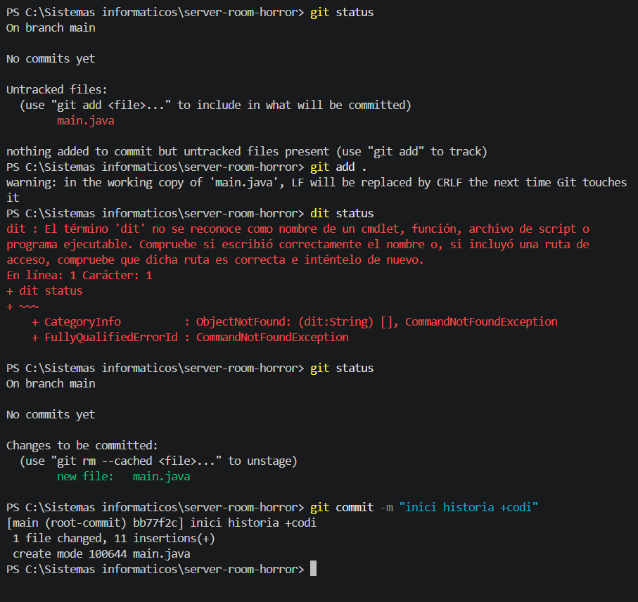
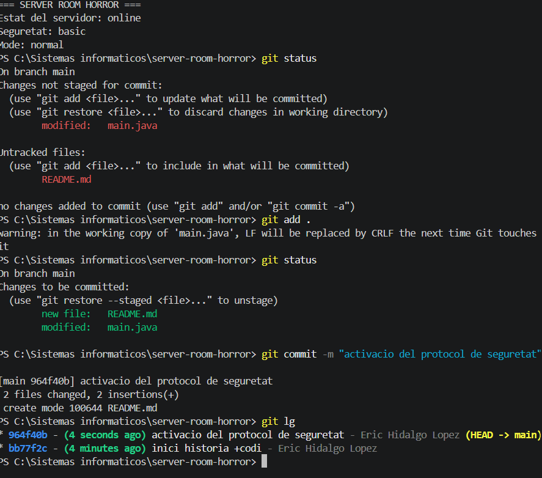
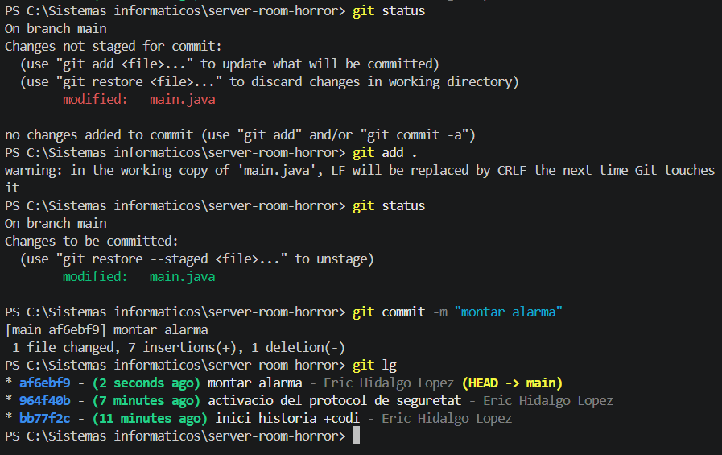
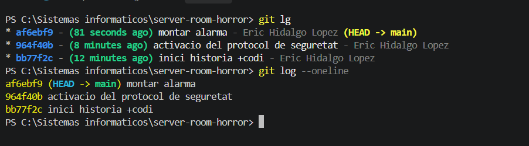

# Bloc 1: Invocació del Repositori i Línia Base

## Acció 3.1 — Crear el repositori

**Explicació tècnica:** s'ha creat el directori `server-room-horror` i s'ha inicialitzat un repositori Git amb la branca principal `main`.

```bash
mkdir server-room-horror
cd server-room-horror
git init -b main
```


## Acció 3.3 — Crear el primer commit

**Explicació tècnica:** s'ha creat `Main.java` amb l'estructura inicial de l'aplicació de monitoratge del servidor.

```bash
git add .
git commit -m "inici historia +codi"
```

**Evidència:**



## Acció 3.4 — Segon i tercer commit

**Explicació tècnica:** s'han afegit els protocols de seguretat i l'activació de l'alarma en dos commits independents.

```bash
git add .
git commit -m "activacio del protocol de seguretat"
git add .
git commit -m "montar alarma"
```

**Evidència:**




## Acció 3.5 — Consultar l'historial

**Explicació tècnica:** s'ha utilitzat el registre simplificat per verificar els tres commits inicials.

```bash
git lg
git log --oneline
```

**Evidència:**

