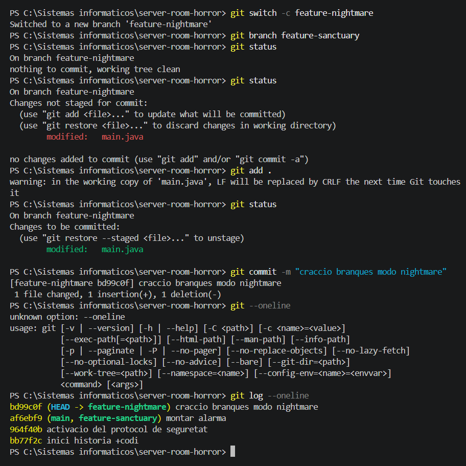
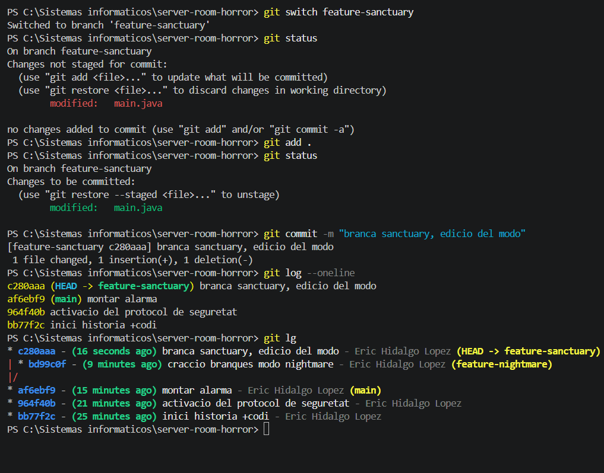
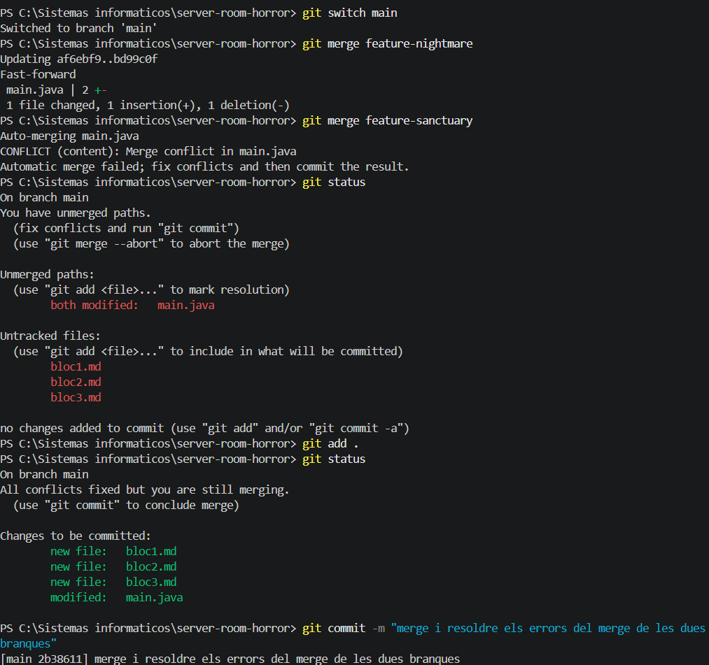
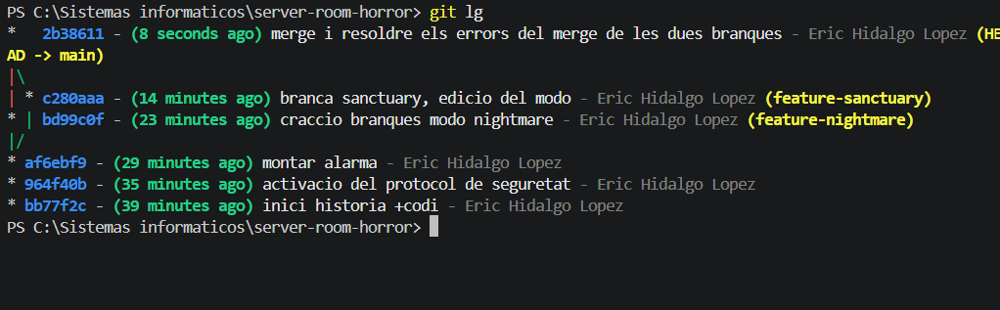

# Bloc 2: Les Branques del Més Enllà i Resolució del Conflicte

## Acció 3.6 — Crear les branques

**Explicació tècnica:** 
Les dues branques s'han creat a partir del tercer commit de `main`. Aquesta topologia permet comparar dues modificacions independents de la mateixa línia de codi.

```bash
git switch -c feature-nightmare
git branch feature-sanctuary
```


## Acció 3.7 — Implementar el mode nightmare

**Explicació tècnica:** s'ha modificat la variable `mode` a la branca fosca per establir el valor `nightmare`.

```bash
git add .
git commit -m "craccio branques modo nightmare"
```

**Evidència:**



## Acció 3.8 — Implementar el mode sanctuary

**Explicació tècnica:** s'ha modificat la mateixa variable a la branca de protecció per establir el valor `sanctuary`.

```bash
git switch feature-sanctuary
git add .
git commit -m "branca sanctuary, edicio del modo"
```

**Evidència:**



## Acció 3.9 — Integrar les branques

**Explicació tècnica:** s'ha integrat primer `feature-nightmare` i després `feature-sanctuary` a la branca principal. La segona integració ha provocat un conflicte perquè les dues branques han modificat la mateixa línia.

```bash
git switch main
git merge feature-nightmare
git merge feature-sanctuary
```


## Acció 3.10 — Resoldre el conflicte

**Explicació tècnica:** s'han eliminat les marques de conflicte de Git i s'ha conservat `String mode = "sanctuary";` com a solució definitiva. La fusió s'ha completat amb un commit.

```bash
git add .
git commit -m "merge: resolve nightmare and sanctuary conflict"
git log --oneline --graph --all
```

**Evidència:**


