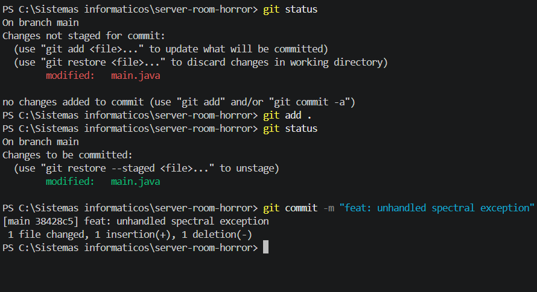
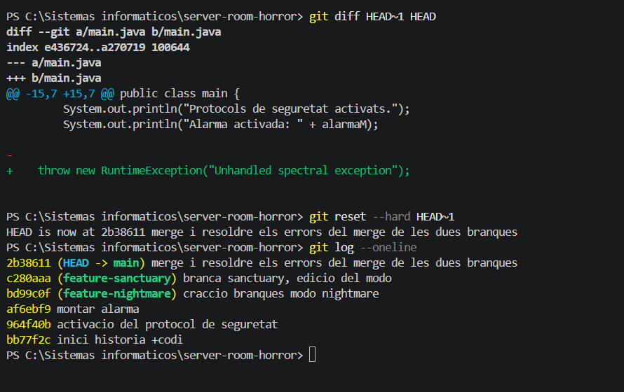
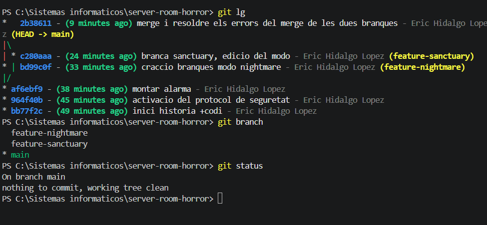
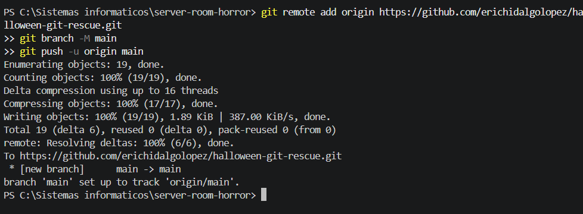

# Bloc 3: Viatge Temporal, Exorcisme del Codi i Publicació Remota

## Acció 3.11 — Crear el commit infectat

**Explicació tècnica:** s'ha afegit una excepció de Java per simular una fallada de producció i s'ha registrat el canvi a l'historial.

```bash
git add 
git commit -m "feat: unhandled spectral exception"
```

**Evidència:**



## Acció 3.12 — Inspeccionar les diferències

**Explicació tècnica:** s'ha comparat el commit infectat amb el seu predecessor per identificar exactament el canvi introduït.

```bash
git diff HEAD~1 HEAD
```

## Acció 3.13 — Restaurar l'estat segur

**Explicació tècnica:** s'ha utilitzat `git reset --hard HEAD~1` per restaurar els fitxers seguits per Git i moure `main` al commit segur anterior.

```bash
git reset --hard HEAD~1
git status
```

**Evidència:**



## Acció 3.14 — Visualitzar l'historial

**Explicació tècnica:** s'ha representat gràficament l'historial per comprovar les branques, la fusió i l'estat de la línia temporal.

```bash
git log --oneline --graph --decorate --all
git branch -v
git status
```

**Evidència:**



## Acció 3.15 — Publicar el repositori a GitHub

**Explicació tècnica:** s'ha configurat el repositori remot i s'han publicat la branca principal i les dues branques de treball.

```bash
git remote add origin https://github.com/EL_TEU_USUARI/halloween-git-rescue.git
git push -u origin main
git push -u origin feature-nightmare
git push -u origin feature-sanctuary

```

**Evidència:**



**Enllaç al repositori:** [https://github.com/erichidalgolopez/halloween-git-rescue]